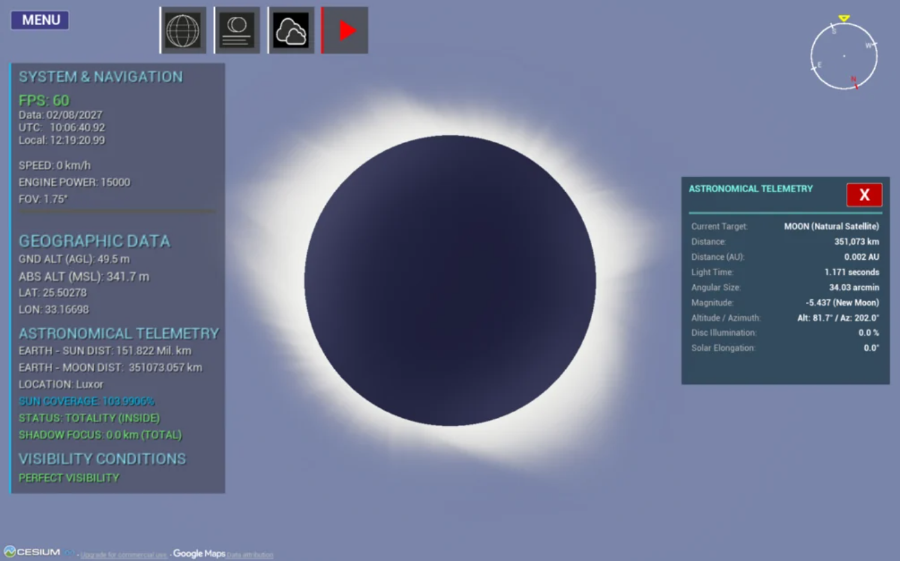
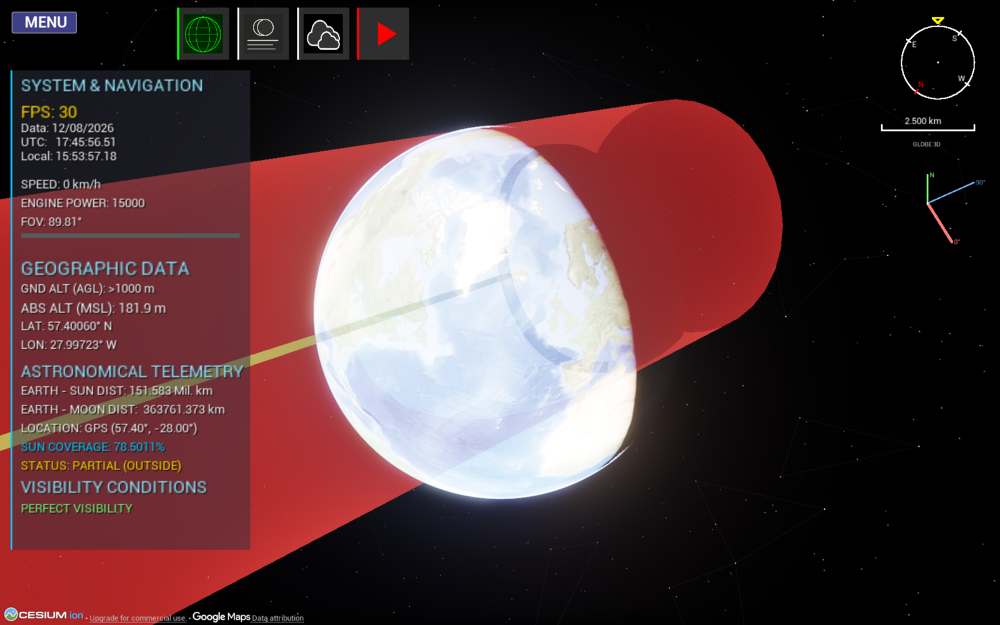

 

# Hi, I'm Dragoș Boncan 👋

**Computer Science Graduate · MSc Data Science Student · Software Developer**

Bucharest, Romania

I build software at the intersection of **scientific computing, machine learning, computer vision, and real-time 3D visualization**. I enjoy turning technically challenging ideas into working applications, with an emphasis on measurable results, clear engineering, and open-source development.

[GitHub](https://github.com/Dragos112358) · [LinkedIn](https://www.linkedin.com/in/dragos-eduard-gabriel-boncan-837b1b354/) · [Personal website](https://dragos112358.github.io/)

---

## Featured Projects

### 🌑 [3D Eclipse Simulator](https://github.com/Dragos112358/Eclipse-Simulator-3D)

An open-source, interactive 3D simulator for solar and lunar eclipses, built with **Unreal Engine 5.7, Cesium for Unreal, C++ and a Python/Skyfield backend powered by JPL DE441**.

  
   
  
  

- Catalogue of **71,264 solar** and **72,272 lunar eclipses**, spanning approximately 30,000 years (13,000 BC–17,000 AD).
- Renders 3D umbra and penumbra cones and their interaction with a **WGS84 ellipsoid**, with geospatial terrain from Cesium.
- Computes solar-eclipse contact times (C1–C4), shadow paths, and city visibility information.
- Includes a lunar-limb elevation model trained on NASA LRO/LOLA data; reported validation RMSE against the gridded DEM: **12.57 m**.
- Contact-time comparisons against Xavier Jubier for three selected total solar eclipses showed a maximum difference of **1.7 seconds** in the documented test cases.

**[Source code](https://github.com/Dragos112358/Eclipse-Simulator-3D)** · **[Trailer](https://www.youtube.com/watch?v=sYdvDpyHnCw)** · **[Full demo](https://www.youtube.com/watch?v=clGfikjfNSE)** · **[Download](https://gabyboncan.gumroad.com/l/txlkbg)** · **[itch.io](https://dragosboncan.itch.io/3d-eclipse-simulator)**

### ♟️ [AI Chess Bot](https://github.com/Dragos112358/ai-chess-bot)

An **AlphaZero-style chess engine** combining a residual policy-and-value network with **Monte Carlo Tree Search (PUCT)**.

- Trains a PyTorch network on Stockfish-evaluated positions, then exports it to ONNX.
- Runs in the browser using `onnxruntime-web`, with WebGPU and WASM fallback; inference runs in a Web Worker.
- Includes a desktop application for training, match arenas, model comparisons, and strength testing against Stockfish.
- Documents benchmark results and their limitations, including the uncertainty of Elo estimates from the current match sample.

**[Repository](https://github.com/Dragos112358/ai-chess-bot)** · **[Play in browser](https://dragos112358.github.io/ai-chess-bot/)**

### 🖼️ [Canny-Core — Parallel Edge Detection](https://github.com/Dragos112358/Canny-Core)

An implementation and performance-study project exploring the **Canny edge-detection algorithm**, from a serial baseline to parallel variants.

- Implementations using **CUDA, OpenMP, Pthreads, MPI**, and hybrid MPI + OpenMP.
- Covers the main Canny stages: Gaussian smoothing, Sobel gradients, non-maximum suppression, double thresholding, and hysteresis edge tracking.
- Includes profiling scripts and comparative performance analysis across implementations.

**[Repository](https://github.com/Dragos112358/Canny-Core)**

---

## Technical Interests & Tools

**Languages**  
`C++` · `Python` · `C`, `Java`, `Matlab`, `.NET` · `HTML/CSS`

**Machine Learning & AI**  
`PyTorch` · `ONNX` · `Neural Networks` · `Monte Carlo Tree Search`

**Scientific & Geospatial Computing**  
`Skyfield` · `JPL DE441` · `Cesium for Unreal` · `WGS84` · `Numerical Geometry`

**Parallel & High-Performance Computing**  
`OpenMP` · `MPI` · `Pthreads` · `Profiling`

**3D & Interactive Applications**  
`Unreal Engine 5` · `Real-Time Rendering` · `Scientific Visualization`

---

## Education & Recognition

- **MSc Data Science** — National University of Science and Technology POLITEHNICA Bucharest *(currently pursuing)*
- **BSc Computer Science** — National University of Science and Technology POLITEHNICA Bucharest
- **Honorable Mention** — Student scientific session, May 2026, for the eclipse-simulation project.

---

## Contact & Links

- **GitHub:** [@Dragos112358](https://github.com/Dragos112358)
- **LinkedIn:** [Dragoș Boncan](https://www.linkedin.com/in/dragos-eduard-gabriel-boncan-837b1b354/)
- **Website:** [dragos112358.github.io](https://dragos112358.github.io/)

*Interested in scientific software, computational astronomy, machine learning, parallel computing, and real-time visualization. Open to constructive feedback, technical discussions, and collaboration.*